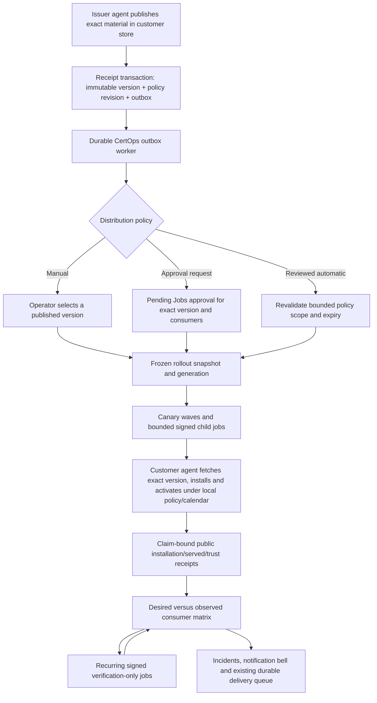

# Certificate distribution lifecycle

This implementation extends the merged #329/#382 baseline for #248. PR #460 was open when this branch was created from `69371864` on 2026-10-27. Its Windows shared-material, OpenBao and Azure implementation and temporary CI trust exceptions were not imported. Existing capability/release gates remain authoritative. This is not a release-qualification claim.

## Operator journey

**Configure → Issue → Publish → Distribute → Verify → Monitor → Renew → Redistribute → Resolve incidents → Retain / reviewed customer-side cleanup**

1. Use the existing [first-distribution guide](vault-first-distribution.md) to opt into shared private keys explicitly, register agents and configure a customer-controlled store. Credentials, paths, approved command references and probes remain customer-local.
2. Open **Certificate Management → Distribution**, or **Manage distribution** in a certificate's read-only **Deployments** section. Select its source and published immutable version.
3. Add consumers using registered agents and local deployment-profile aliases. Set required/optional status, wave, verification assurance and freshness. Revision changes invalidate previous authorization. Reassignment is refused while the previous destination has live or uncertain work.
4. Configure activation policy per consumer. Request a rollout, review the exact destination/version intent in Jobs where approval is required, and inspect each child's evidence. A request, approval, publication, file installation, live serving and trust are different outcomes.
5. Enable recurring verification and distribution incidents deliberately. Both are disabled initially. Configure contact groups and thresholds. Existing workspace notification channels, delivery windows, recipient eligibility, quotas and retries apply.
6. Investigate failures through the original job, run metadata preflight and customer-local preflight, reconcile uncertain local effects, retry the original signed intent and resume where allowed. Obtain fresh verification before treating the incident as resolved.
7. Preview retention reasons. After independent native qualification and explicit local/runtime/group opt-in, administrators can request exact-version Vault soft-deletion approval. Cleanup uses the existing signed-job/lease infrastructure and a permanent reference fence. It remains disabled for the currently unqualified cleanup capability. See the [retention and cleanup protocol](distribution-retention-cleanup.md).

## Event flow and custody



The control plane has no material-store network client. It stores aliases, immutable public identities, version references, scope hashes, approval/audit records, scheduling state and public evidence. Private keys and store credentials never enter lifecycle policies, jobs, API responses, outbox records or notifications. Customer-local preflight can read an exact bundle into agent memory; it returns diagnostic codes only.

Publication records its policy revision in the same transaction as the existing `material_published` outbox event. A delayed event cannot adopt a changed policy. Group locks, deterministic `post-publication:<version>` job keys and a unique workspace/group/version automation record make duplicate delivery, concurrent workers and acknowledgement loss logically idempotent. Superseded publications cannot silently become automatic rollbacks.

## Post-publication policies and human approval

| Mode | Behavior |
| --- | --- |
| `manual` | Default. Publish and expose consumer lag; no automatic rollout. |
| `approval_request` | Create a genuine pending Jobs approval for the exact immutable version and current destination snapshot. Notify reviewers through the existing notification bell. |
| `preauthorized` | Require an independently reviewed policy job, a maximum 30-day expiry and an unchanged public scope. No approval ledger row is manufactured for later versions. |

The standing approval contains the reviewable destination list, local/profile and authorization revisions, activation classes/calendars, required/optional flags, waves, maximum parallelism and fixed rollout/failure behavior, together with its canonical scope hash. Workspace approval policy/revision, owner/reviewer membership, source authority, management period and policy configuration participate in that scope. These are revalidated before expansion and dispatch; changed membership, reviewer revocation, policy changes or expiry refuse execution. Saving the same settings after a scope change creates a new revision and genuine review request.

Mandatory workspace approval is never overridden by standing authority. Disruptive/explicit-approval activation, every retained-version deployment and every cleanup job require a genuine exact-intent human approval. Child jobs retain the existing independent workspace approval rules. Reviewers must satisfy the existing Jobs permissions and non-requester rule. Cancelled/rejected approval notices close without claiming deployment success.

## Maintenance and activation

Activation classes are `none`, `reload`, `rebind`, `no-restart-refresh`, `controlled-restart` and `manual`. The merged Linux material executor supports file-only `none` and approved local `reload`. Other mutating classes remain unavailable until their connector is implemented and qualified. Manual customer activation can be followed by an authorized verification-only job; it does not authorize automatic service mutation.

Calendars use IANA zones, weekday windows and explicit ISO-instant blackouts. Overnight and overlapping windows are supported. Real UTC instants are evaluated in local wall time: nonexistent DST minutes never occur; both repetitions of a fallback hour follow that wall-time window. Window ends and blackout ends are exclusive. Blackouts override ordinary windows and emergency exceptions. A disruptive activation without an allowed window waits.

Source issuance and secure store publication may finish before the activation window. The current Linux consumer executor defers the complete destination deployment rather than introducing an independently resumable per-consumer staging phase. Calendar admission is checked before dispatch and again customer-side, including immediately before reload. Losing the window after files changed leaves uncertain effects for reconciliation, never a false success.

Per-consumer authorization expiry is independent of certificate validity. `POST .../consumers/:bindingId/emergency` requires `certops.distribution.emergency` (workspace admin), exact group/binding/revision scope, an audit reference and at most four hours. Administrators can configure and confirm this exception in the consumer's Maintenance form. It changes the authorization revision and still requires explicit rollout approval. There is no arbitrary command or shell field.

Monitoring escalates when no activation fits before the earlier desired/deployed certificate expiry. A bounded 35-day search reports an explicit horizon-exceeded escalation rather than silently assuming a future window exists. Stale canary proof pauses progression; historical successful stages alone cannot authorize later waves or complete a rollout.

## Continuous verification and incidents

Verification policy remains per consumer (`installed`, `served`, `trust`) with per-consumer freshness. Group policy controls enablement, interval, maximum backoff, stale-job threshold and escalation tolerance. Schedules persist sequence, due time, job reference, outcome and failure count. Workspace/group locks and a due-time recheck serialize concurrent schedulers. Each run pins the existing desired version; it never adopts a new publication just because a timer fired.

The scheduler uses the existing signed verification-only path, concurrency limits and authorization. It waits for in-flight/paused rollouts, unresolved effects and pending approvals and backs off required offline agents. Existing job/lease reaping remains authoritative: the scheduler does not steal a live claim or clear uncertainty. This is a group-level schedule; recovery of a blocked required consumer may be needed before a subsequent full-group verification run.

Consumer health separates fresh convergence, installed-only assurance, served-without-trust proof, old material, drift, overdue verification, offline agents, incomplete coverage, failed verification and uncertainty. The management page expires cached fresh-proof labels at evidence deadlines using the existing server-clock/deadline hook. Source renewal never supplies consumer verification.

Monitoring detects publication/rollout failures, stuck work, required offline consumers, overdue proof, fingerprint/version drift, older deployed material, deployed expiry/near expiry, uncertainty, missed maintenance and publication without required-consumer convergence. Publication job failure is detected even if its allocated version remains unresolved.

Incidents have stable workspace-scoped identities, opened/updated/resolved audit evidence, deduplicated bell items and redacted links. Delivery uses `alert_queue` and the existing worker, anchored to the actual customer agent instead of manufacturing a token. Group routing is resolved again at delivery time. Email/webhooks retain the existing controls; WhatsApp uses an explicitly configured `TWILIO_WHATSAPP_ALERT_CONTENT_SID_DISTRIBUTION` template with `recipient_name`, `incident` and `evidence_url` placeholders. An absent template fails visibly through the normal retry path. PagerDuty payloads retain a stable incident deduplication key and an explicit resolve action.

Reminders are configurable with a minimum one-hour interval; a workspace cap of 20 distribution queue entries/hour bounds incident storms. Generic verification failures notify after the configured attempt threshold; identity drift and expiry remain independently actionable. Delivery retries do not re-create incidents. A consumer incident resolves only when fresh, current-version proof postdating its latest changed condition establishes convergence. Source publication, heartbeat recovery, local repair alone, older evidence or removal of a destination cannot resolve it.

## Discovery and recovery

Configured binding IDs are stable across renewal. Jobless, credential-authenticated discovery additionally records a stable service key from workspace, agent, host, location kind and exact listener/configuration slot. Fingerprint rotation updates its observation without replacing its identity. Existing IIS/HTTP.sys observations confirm a relationship, not live served/trust assurance; Linux file observations remain configured/unconfirmed. Windows store-only entries do not become service consumers. Coverage remains explicitly partial, including offline/stale or unsupported roles. This does not add new RDP/SQL/appliance/firewall/TPM/KSP connectors.

`GET .../preflight` performs non-mutating metadata checks and returns stable public codes for offline/capability/version/window/connector/reconciliation conditions. It explicitly reports customer-local checks as unknown. Distribution Management can download a public, exact-version preflight intent for each consumer, including before its first deployment. This planning metadata creates no job or execution authority. The API does not retrieve private material or claim to know local permissions.

On an agent with an existing pinned binding journal, run:

```text
certops-preflight-binding <binding-uuid>
certops-preflight-binding <binding-uuid> --intent /protected/public-intent.json
certops-reconcile-binding <binding-uuid>
```

Without `--intent`, preflight uses the existing protected binding journal. Before a first deployment, supply the public intent downloaded from Distribution Management, protected with the same owner-only permissions as agent metadata (for example, `chmod 600` on Linux). Only the public material-deployment fields are accepted; credentials, paths and another binding are rejected. The customer-local binding/store policy remains authoritative.

Preflight reads the exact store version, verifies local scope/revisions and the calendar, checks destination access, configured reload references/probes and existing lock/uncertain metadata without acquiring a lock, creating a directory, installing files or running commands. It can establish a configured TLS listener's presence through a read-only handshake. An unreachable/unknown service remains explicitly unverified. Listener presence is separate from proof that a new version is installed, served or trusted. Reconciliation remains a separate explicit operation and proves the installed pair and required listeners before changing its local uncertain marker. A live lock is never removed by these tools. For a crashed lock owner, follow the existing customer-local ownership investigation before any manual repair.

Retry preserves the original signed payload/version/generation and independently rechecks current membership, desired generation, exact version, approvals and automatic policy authority. The server keeps an uncertain deployment visibly uncertain while retry is pending. Neither local reconciliation nor retry request alone promotes deployment status; a fresh claim-bound receipt is required.

## Retention and provider limitations

Retention configuration controls minimum duration, minimum published-version count and rollback preservation. Preview explains protection for latest material, desired/observed consumer references, in-flight/pending approvals, resumable/paused rollouts and failed/uncertain/reconcilable work. Public version, approval, job and incident history remains intact.

Metadata eligibility is **not** deletion authorization. The [cleanup protocol](distribution-retention-cleanup.md) implements independently approved, exact-version customer-side Vault soft deletion. It rechecks eligibility at claim, creates a permanent database reference fence before external effects, enforces a customer-local retention floor and accepts a fresh claim-bound metadata receipt. Minimum retained counts exclude already fenced versions. No destroy, metadata deletion, all-version deletion or purge is exposed.

[Vault KV v2](https://developer.hashicorp.com/vault/api-docs/secret/kv/kv-v2) distinguishes reversible version soft deletion, permanent version destruction and metadata/all-version deletion. [Azure Key Vault secret deletion](https://learn.microsoft.com/en-us/rest/api/keyvault/secrets/delete-secret/delete-secret?view=rest-keyvault-secrets-2025-07-01) operates on the secret and its versions; it does not provide arbitrary individual-version deletion. Azure soft delete, recovery and purge protection must be honored by a separately reviewed operation. OpenBao/Azure/Windows material extensions remain dependent on #460 and protected qualification.

## API, migrations and deployment

New manager/session administration endpoints extend `/api/v1/workspaces/:id/certops/distribution-groups/:groupId`:

| Endpoint | Purpose |
| --- | --- |
| `GET /management` | Bounded public consumer/version/rollout/approval/incident/discovery overview and readiness preview. |
| `GET, PUT /policy` | Manual defaults and revision-checked automation/verification/alert/retention policy. |
| `PUT /consumers/:bindingId/activation-policy` | Revision-fenced calendar and activation contract. |
| `POST /consumers/:bindingId/emergency` | Additional administrator-only bounded emergency authorization. |
| `GET /preflight` | Explicitly incomplete, non-mutating control-plane preflight. |
| `GET /retention` | Non-destructive retention eligibility and protection reasons. |
| `POST /cleanups` | Administrator-only exact-version soft-deletion approval request or explicit fresh review. |

Existing binding, exact-version rollout, pause/resume, retry and Jobs approval APIs are reused. Existing distribution read/write role restrictions, key rejection and global/workspace kill switches remain. No new credential entry surface is added.

Apply migrations before starting the updated API/worker. Additive migrations **79–82** introduce lifecycle policy/schedules/incidents, incident delivery metadata, stable discovery and exact-object cleanup fences. Migrations through main's 78 are unchanged; the existing ledger composition and real upgrade tests remain. A workspace authorization-revision trigger invalidates standing scope after approval/kill-switch changes. Existing installations have no policies, so automation/verification/alert behavior remains manual/disabled and cleanup stays report-only. Retained-version real deployments and cleanup jobs always request explicit human approval.

Deploy the matching API and worker and upgrade agents before enabling calendars (`maintenance-calendar-v1`). Existing qualified material-store/deploy capability gates still apply. Cleanup additionally requires `CERTOPS_MATERIAL_CLEANUP_ENABLED=true`, a non-report-only enabled group policy, local opt-in and a freshly declared `material-cleanup-vault-kv2-v1` capability from an independently qualified build. The release manifest is unchanged and omits that new capability. New workers expose independently configurable `CERTOPS_SWEEP_DISTRIBUTION_SCHEDULER_ENABLED` / `CERTOPS_SWEEP_DISTRIBUTION_MONITORING_ENABLED` and corresponding `_TIMEOUT_MS` settings. Monitoring can continue while execution is paused.

PR #460 independently uses an unapplied migration 79. Before integrating both branches, sequence their **unapplied** migrations without rewriting any deployed ledger entry, retain all lifecycle/transfer fences and re-run both migration histories. This branch deliberately does not reinterpret an unknown ledger or enable #460's capabilities.

See [implementation and qualification status](distribution-lifecycle-status.md) before deployment.
