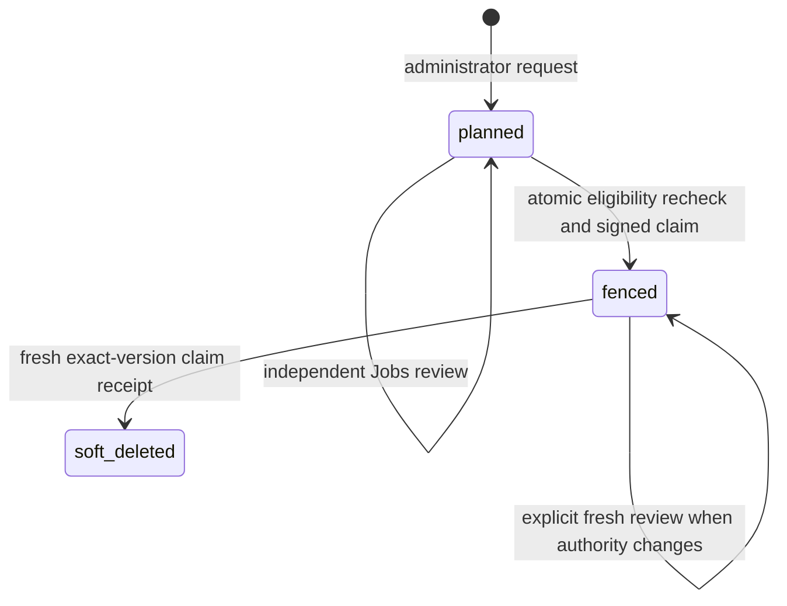

# Customer-side retention and exact-version cleanup

Retention preview never authorizes deletion. The optional `cleanup-from-store` job implements **Vault KV v2 version soft deletion** on a customer agent, after a separate human approval. It does not destroy versions, remove metadata/all versions, purge objects or implement Azure deletion. Public material, job, approval and incident history remains.

Existing workspaces retain manual/report-only defaults: minimum 30 days, three versions and seven days of rollback preservation. Cleanup is disabled. The current release manifest does **not** qualify `material-cleanup-vault-kv2-v1`; runtime settings cannot enable that capability in an unqualified binary.

## Operator workflow

1. Review the customer-owned group/store namespace and all known consumer references. Configure the retention duration, minimum count and rollback period in Distribution Management. Zero durations are explicit policy choices; at least two available versions remain protected. Customer-local policy can enforce a stricter duration.
2. Keep **Report only** enabled to inspect reasons without creating work. Referenced material, pending approvals, current desired/observed versions, resumable rollouts and uncertain/reconcilable operations remain protected.
3. After the agent operation is qualified, configure its local cleanup policy and metadata-only credential, enable `CERTOPS_MATERIAL_CLEANUP_ENABLED=true` on the API and enable cleanup requests with report-only disabled for the group.
4. An administrator selects an eligible exact version and confirms **Request cleanup approval**. Jobs contains the immutable version/provider reference, customer store alias, local profile revision, policy revision, retention settings, scope hash and bounded expiry. A different authorized reviewer approves it through existing Jobs permissions. Workspace-wide approval settings or a standing rollout grant cannot bypass this approval.
5. At agent claim, the API rechecks current scope and eligibility under workspace/group locks, then permanently fences that material version in the same transaction as dispatch. Concurrent rollout admission and cleanup cannot both win. Each subsequent claim/lease renewal revalidates the current authorization.
6. The customer agent checks its own opt-in, profile revision, retention floor, exact store metadata and live lease. It soft deletes only the signed provider version, reads fresh metadata and returns a claim-bound public receipt. No private bundle is fetched by cleanup.
7. Inspect the cleanup job and **planned / fenced / soft deleted** state in retention preview. Approval, dispatch and completion are separate states. The original immutable publication record remains visible in history; a fenced/cleaned version is excluded from rollback selection.

The intent expires after at most 24 hours. Changing relevant policy, membership, reviewer authority, ownership or source/store configuration invalidates old authority. A material version whose original store profile differs from the current group is protected rather than guessed to belong to a new namespace.

## Customer-local configuration

Add this fragment under the existing `materialStores.<alias>.groups.<group UUID>` entry; keep the existing workspace, prefix, SAN and key-algorithm scope:

```json
{
  "cleanup": {
    "softDelete": true,
    "profileRevision": 1,
    "minimumSeconds": 2592000,
    "tokenFile": "/etc/tokentimer/credentials/group-cleanup.token"
  }
}
```

The protected token file stays on the customer agent. It is separate from issuance/consumer credentials. The existing agent execution policy and registered target selectors must permit the exact group UUID, which is the cleanup job's endpoint reference. No public API accepts a Vault endpoint, namespace, path, token file, token value or command for cleanup.

A narrowly scoped Vault policy can grant only:

```hcl
path "secret/metadata/<customer-prefix>/<group>/bundles/*" {
  capabilities = ["read"]
}
path "secret/delete/<customer-prefix>/<group>/bundles/*" {
  capabilities = ["update"]
}
```

Do not grant data reads, destroy, metadata deletion or purge for this operation. The group prefix comes from existing customer-local configuration, and the agent derives its exact object from the immutable material UUID. The signed intent contains one positive provider-version integer, never an arbitrary path or version list. Namespace, TLS CA and transport settings remain the existing local store settings.

The API requires an active, recently seen issuer agent with fresh material-store and cleanup capabilities. The agent independently applies its compiled qualification gate and Linux platform gate. Qualification of existing publication/deployment capabilities does not qualify cleanup.

## Durable fencing and recovery



The `certops_material_cleanups` row is public lifecycle history. SQL triggers prevent new job, rollout or current-consumer references to a fenced/soft-deleted version. Lease expiry, rejection, cancellation, restart and local repair never release the fence. The material-version identity and the fence cannot be reassigned to another workspace/group/version. The minimum retained-version calculation excludes already fenced versions, so concurrent cleanup plans cannot each count the other's material as a surviving rollback copy.

For an interrupted delete, inspect the original job and customer-local journal. Retry the original authorized job through the existing distribution retry action after fixing local prerequisites. The agent checks fresh metadata first: an already soft-deleted version yields a fresh receipt without issuing another delete. A missing/destroyed object is reported explicitly rather than claimed as a successful soft deletion. Live local locks are never stolen.

If authority changed or expired, **Request fresh cleanup review** creates a new independently approved job for the same fenced object. A live claimed/running job cannot be replaced. Historical uncertain jobs and local journals remain intact; re-review does not silently clear their reconciliation state. Each new job has a separate local journal while the permanent object fence remains.

Restoring bytes customer-side does not make the old fenced UUID deployable again. Any subsequent managed publication must use its own immutable version and normal authorization. Whole-workspace deletion explicitly removes that workspace's lifecycle metadata transactionally; secret-store cleanup itself never deletes public history.

## API and scope

`POST /api/v1/workspaces/:id/certops/distribution-groups/:groupId/cleanups` requires an administrator cookie session, active workspace and the existing CertOps write guards:

```json
{
  "materialVersionId": "<exact immutable material UUID>",
  "expectedRevision": 3,
  "reauthorize": false
}
```

The closed request accepts no provider credentials or private material. Duplicate requests return the existing logical request. New destructive jobs always require genuine approval, including when created through the generic job service. Authorization and eligibility are rechecked at claim, not trusted from a cached preview. The control plane stores public approval scope, fences, receipts and audit events only.

[Vault KV v2](https://developer.hashicorp.com/vault/api-docs/secret/kv/kv-v2#delete-secret-versions) separates soft deletion, destruction and metadata deletion. This connector implements the first operation only. OpenBao/Azure extensions remain dependent on merged implementation and qualification; arbitrary Azure individual-version deletion is unavailable. No generic delete/purge interface is exposed.

Migrate through **82** before updated API/worker/agents. See the [lifecycle guide](distribution-lifecycle.md) and [current implementation/qualification matrix](distribution-lifecycle-status.md). Real isolated Vault metadata/delete ACL tests, PostgreSQL reference races, signed claims/nonces, retained-count concurrency, uncertain retry and fresh re-review are functional support evidence; they do not promote a shipped native capability.
